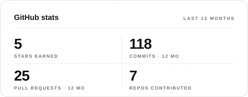
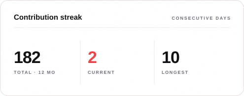
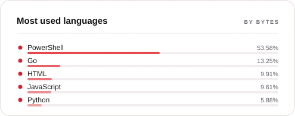
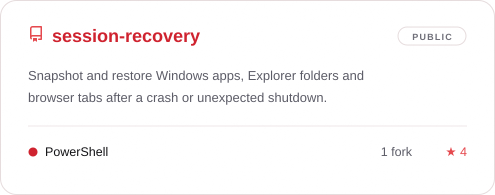
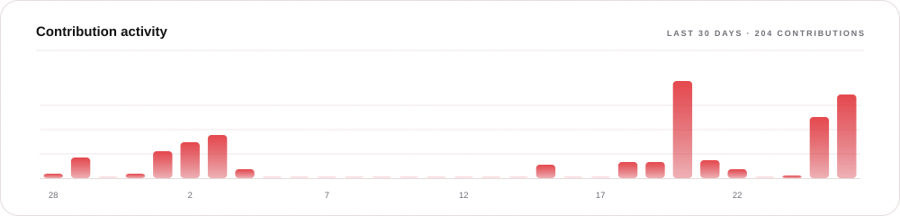

  <picture>
    <source media="(prefers-color-scheme: dark)" srcset="./assets/banner-dark.svg" />
    
  </picture>

### Hey, I'm Meskine Morty 👋

I build small, sharp tools: Windows automation, streaming and reverse-engineering utilities, and
Android / iOS apps. Self-hosted where possible, read-only where it matters, and always aimed at a
problem I actually ran into.

---

01 — ACTIVITY

## 📈 Contributions &amp; Activity

<picture>
  <source media="(prefers-color-scheme: dark)" srcset="./assets/stats-dark.svg" />
  
</picture>
<picture>
  <source media="(prefers-color-scheme: dark)" srcset="./assets/streak-dark.svg" />
  
</picture>

<picture>
  <source media="(prefers-color-scheme: dark)" srcset="./assets/languages-dark.svg" />
  
</picture>
<picture>
  <source media="(prefers-color-scheme: dark)" srcset="./assets/pinned-dark.svg" />
  
</picture>

  <picture>
    <source media="(prefers-color-scheme: dark)" srcset="./assets/activity-dark.svg" />
    
  </picture>

  <picture>
    <source media="(prefers-color-scheme: dark)" srcset="https://raw.githubusercontent.com/Bilalmesk/Bilalmesk/output/github-contribution-grid-snake-dark.svg" />
    
  </picture>

---

02 — WORK

## 🚀 Featured Projects

| Project | What it does | Stack |
| :-- | :-- | :-- |
| ⭐ **[session-recovery](https://github.com/Bilalmesk/session-recovery)** | Snapshot and restore Windows apps, Explorer folders and browser tabs after a crash or unexpected shutdown. | `PowerShell` |
| **[opencode-usage-tracker](https://github.com/Bilalmesk/opencode-usage-tracker)** | Local, read-only OpenCode usage dashboard for free, Go, Zen and external providers. | `HTML` `JavaScript` |
| **[mihon-extensions](https://github.com/Bilalmesk/mihon-extensions)** | Mihon / Tachiyomi extensions for Arabic manga sources. | `Kotlin` |
| **[netflix-speed-keys](https://github.com/Bilalmesk/netflix-speed-keys)** | Keyboard shortcuts for Netflix playback speed, with synchronized subtitles. | `JavaScript` |

Also on GitHub: **[winget-pkgs](https://github.com/Bilalmesk/winget-pkgs)** — a fork of the Windows Package Manager manifest repository.

---

03 — STACK

## 🧰 Toolbox

  <picture>
    <source media="(prefers-color-scheme: dark)" srcset="https://skillicons.dev/icons?i=powershell,js,html,kotlin,windows,git,github&amp;theme=dark" />
    
  </picture>

---

04 — NOW

## 🌱 Currently

- 🔭 Building **[opencode-usage-tracker](https://github.com/Bilalmesk/opencode-usage-tracker)** — local-first, read-only usage analytics.
- 🧩 Maintaining **[mihon-extensions](https://github.com/Bilalmesk/mihon-extensions)** for Arabic manga sources.
- 🧪 Exploring agent-driven reverse engineering in **[rea](https://github.com/Bilalmesk/rea)** — from app behaviour down to native binaries.
- 🐍 Watching the snake above eat my contribution graph — it's hungry, so issues and PRs are welcome.

<i>Build the tool you wish existed.</i>

